<h1 align="center">Olá, eu sou o Bruno! 👋</h1>

<h3 align="center">Estudante de Engenharia de Software | Desenvolvimento de Software</h3>

  

## 🔗 Redes sociais

  
  
  

---

## 🚀 Sobre mim

Sou estudante de **Engenharia de Software**, do Brasil 🇧🇷, interessado em desenvolvimento de software, backend, Cloud e Inteligência Artificial.

Atualmente, estou focado em fortalecer meus fundamentos de programação e desenvolver projetos próprios, buscando transformar conhecimentos teóricos em experiência prática.

- 💻 Estudando desenvolvimento backend e fundamentos de programação.
- 🗄️ Experiência com bancos de dados relacionais e desenvolvimento de APIs.
- 🐳 Já utilizei Docker e Docker Compose em projetos acadêmicos.
- 🔀 Boa familiaridade com Git, GitHub e práticas de colaboração.
- ☁️ Aprofundando conhecimentos em Linux, Cloud e DevOps.
- 🤖 Explorando LLMs, agentes de IA e automação.
- 🎯 Buscando uma oportunidade de estágio em desenvolvimento de software.

---

## 🧰 Tecnologias e ferramentas

### ⭐ Mais familiaridade

  

`Git` · `GitHub` · `Branches` · `Pull Requests` · `Merge`

`Conventional Commits` · `feat` · `fix` · `docs` · `chore` · `refactor` · `test`

`MySQL` · `SQL` · `HTML5` · `CSS3` · `JavaScript (JS)`

`Visual Studio Code (VS Code)` · `Linux`

**Inteligência Artificial e agentes:**

`CrewAI` · `MCP (Model Context Protocol)` · `Claude` · `ChatGPT` · `Gemini` · `LLMs`

Tenho maior segurança de uso com Git, GitHub e MySQL. Também tenho familiaridade com HTML, CSS, JavaScript, VS Code e Linux. Em IA, estou tendo contato prático com agentes, LLMs e MCP por meio dos estudos e do bootcamp Bradesco.

### 🛠️ Já desenvolvi ou utilizei em projetos

  

`JavaScript` · `Node.js` · `Express` · `React`

`Java` · `Maven` · `APIs REST` · `JWT`

`Docker` · `Docker Compose`

`Cloudflare Pages` · `Render` · `Aiven`

### 📚 Em aprendizado e aprofundamento

  

`Python` · `Linux` · `Docker` · `AWS` · `GitHub Actions`

`Cloud Computing` · `CI/CD` · `Automação de infraestrutura`

`Engenharia de Prompts` · `CrewAI` · `MCP` · `Agentes de IA`

**Inteligência Artificial:** LLMs, Engenharia de Prompts, CrewAI e MCP.

# Cursos/Bootcamps atuais

 

  <strong>11% completo</strong>

### [🔗Bootcamp Bradesco - Agentes de IA do Zero a Prática](https://web.dio.me/track/bradesco-agentes-de-ia-do-zero-a-pratica)

 

  <strong>40% completo</strong>

### [🔗Curso HTML5 e CSS3: módulo 2 de 5 40 HORAS](https://www.cursoemvideo.com/curso/curso-html5-e-css3-modulo-2-de-5-40-horas)
---

## 📦 Projetos em destaque

### 🏗️ SGP — Sistema de Geração de Provas

Projeto acadêmico colaborativo para criação e gerenciamento de avaliações, com funcionalidades de autenticação, provas, turmas e gerenciamento de usuários.

Minha participação envolveu a organização técnica, decisões de arquitetura e diagramas, além de atividades relacionadas à autenticação e segurança do sistema.

Também participei da configuração e publicação da aplicação, utilizando Cloudflare Pages para o frontend, Render para a API e Aiven para o banco de dados MySQL.

**Tecnologias:** JavaScript, React, Node.js, Express, MySQL, JWT, Cloudflare Pages, Render e Aiven.

[🔗 Repositório da equipe](https://github.com/Felipe-S-prog/Projeto-e-Arquitetura-5-fase)

---

### 🧪 Testes de Software e CI/CD

Repositório de estudos e experimentações práticas com testes de software e automação de processos utilizando GitHub Actions.

Durante os exercícios, tive contato com pipelines de CI, execução automatizada de testes com Maven, relatórios de cobertura com JaCoCo, matrizes de execução em diferentes sistemas operacionais e processos de CD para publicação de releases.

**Tecnologias:** Java, Maven, GitHub Actions, CI/CD e JaCoCo.

[🔗 Repositório](https://github.com/brunow27/ci-teste-software)

---

### 🏥 Projeto Clínica

Projeto acadêmico de extensão com protótipo de interface, documentação, levantamento de requisitos e modelagem de uma solução web para uma clínica de estética.

O projeto também apresenta uma proposta de arquitetura para backend e banco de dados, ainda não implementada no protótipo.

**Tecnologias utilizadas:** HTML5, CSS3 e JavaScript. 

**Arquitetura proposta:** Python, Flask e MySQL.

[🔗 Repositório](https://github.com/brunow27/projeto_clinica)

---

## 📊 Estatísticas do GitHub

  
  

  

---

  <i>Aprendendo, construindo e evoluindo um projeto de cada vez. 🚀</i>

  Obrigado pela visita!

